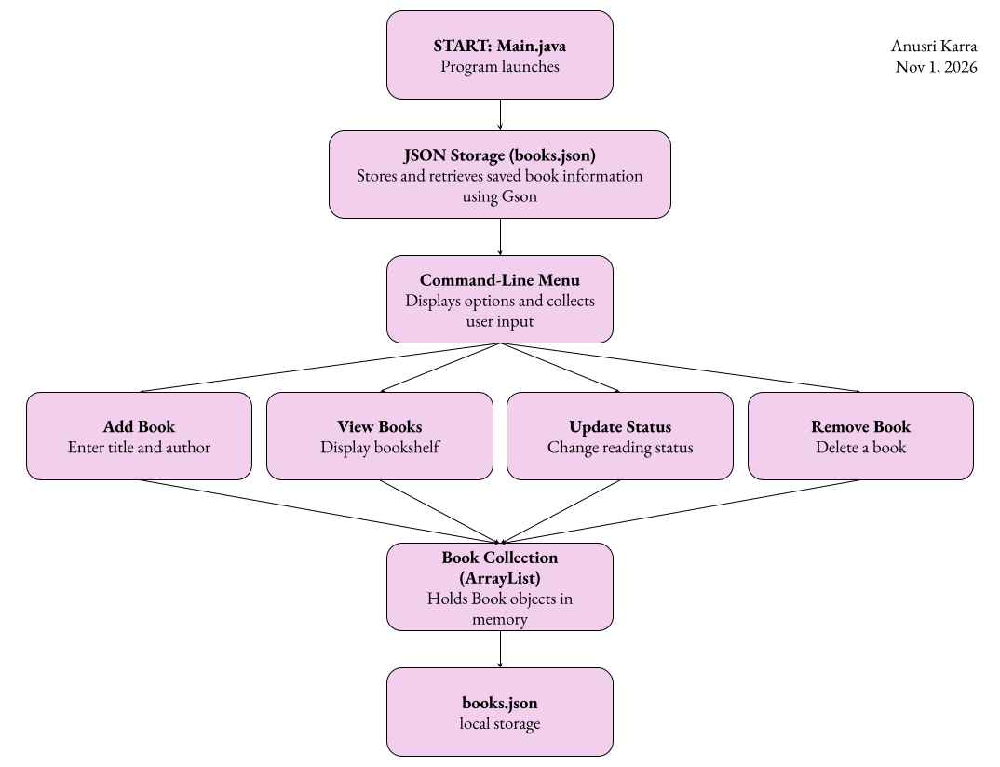

# The Reading Room

A personal book-tracking application that helps readers organize their books, manage reading progress, and maintain a digital bookshelf.

## The Problem

I enjoy reading and discovering new books, but keeping track of books I want to read, books I'm currently reading, and books I've already finished can become disorganized. I want to create a personal reading management platform that brings book tracking, reading progress, personal reviews, and book discovery together in one place.

## How It Works

The Reading Room will be a Java command-line application that allows users to maintain a digital bookshelf. Users will be able to add books by title and author, view their saved books, organize them into Want to Read, Currently Reading, and Finished categories, update reading statuses, and remove books. Book information will be saved locally so that the collection persists between application sessions.

## Tech Stack

- **Language:** Java
- **Libraries:** Gson for converting book information to and from JSON.
- **External Tools:** Open Library API (planned for future integration).
- **Data Structures:** ArrayList for managing the book collection.
- **Data Storage:** Local JSON file (`books.json`).
- **Java Packages:** Scanner, java.io, java.nio.file, and java.time.

## Setup

The application is currently in the initial planning and setup stage and is not yet executable.

Clone the repository:

    git clone https://github.com/anu-karra/the_reading_room.git
    cd the_reading_room

Additional setup instructions and dependency installation steps will be provided as development progresses.

## Usage

The application is not yet implemented. Once development is complete, users will be able to launch the command-line application and navigate its menu to:

1. Add books to their personal bookshelf.
2. View all saved books.
3. Update a book's reading status.
4. Remove books from their collection.

## Roadmap

- [ ] Track reading progress.
- [ ] Add personal book ratings and reviews.
- [ ] Organize books by genre and tags.
- [ ] Search and filter the bookshelf.
- [ ] Set reading goals.
- [ ] Display reading statistics.
- [ ] Add book cover images.
- [ ] Integrate the Open Library API.
- [ ] Explore personalized book recommendations.

## Author

Anusri Karra

[GitHub Profile](https://github.com/anu-karra)
